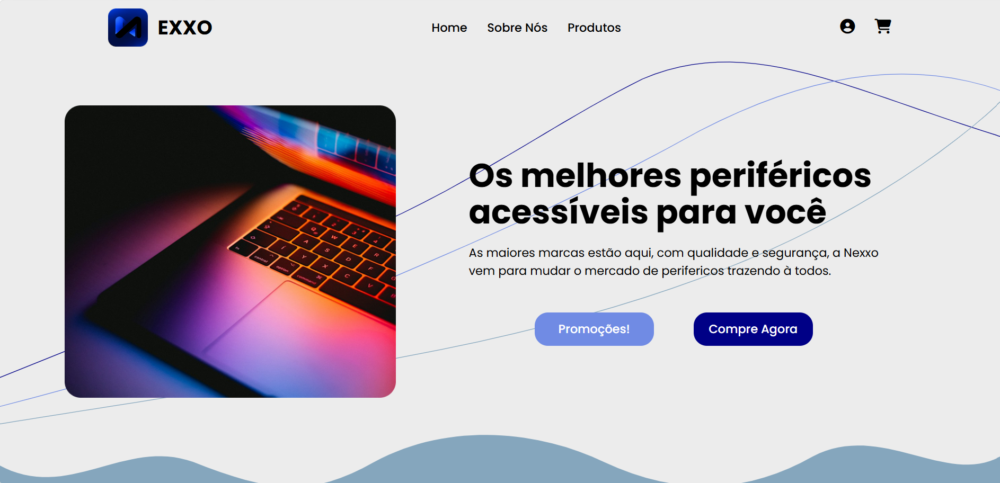

# 🛒 Nexxo | E-commerce de Eletrônicos

### Tecnologia, design e acessibilidade em uma experiência de compra.

  

A **Nexxo** é um projeto de e-commerce voltado à comercialização de eletrônicos e periféricos, desenvolvido com foco em uma interface moderna, navegação intuitiva e apresentação visual dos produtos.

O objetivo é simular a experiência de uma loja virtual, explorando diferentes páginas e componentes de uma aplicação web.

 

---

## 📖 Sobre o projeto

A **Nexxo** foi desenvolvida como uma proposta de loja virtual especializada em produtos tecnológicos, como teclados, mouses, monitores, headsets e acessórios.

O projeto apresenta uma identidade visual baseada em tons de azul, elementos gráficos decorativos e componentes que simulam a navegação por um e-commerce.

Além da página inicial, foram desenvolvidas interfaces para autenticação, criação de conta e visualização detalhada de produtos.

A aplicação está em desenvolvimento, com foco atual na construção e no aprimoramento da experiência Front-End.

## 🖥️ Prévia do projeto

 

*Conheça a interface completa acessando a versão publicada.*

---

## ⚙️ Funcionalidades

- **Página inicial:** apresentação da marca, navegação e área promocional.
- **Catálogo de produtos:** exibição de eletrônicos e periféricos em cards.
- **Informações comerciais:** apresentação de preços, descontos e produtos em destaque.
- **Página de produto:** visualização de imagem, descrição, avaliação, preço e disponibilidade.
- **Área de frete:** campo expansível para inserção de CEP na página de compra.
- **Tela de login:** interface para entrada de usuário e senha.
- **Tela de cadastro:** formulário para preenchimento de informações pessoais.
- **Navegação entre páginas:** links para acessar as diferentes interfaces do projeto.

> **Observação:** o projeto é um protótipo Front-End. Recursos como autenticação, cadastro de usuários, cálculo real de frete, carrinho e processamento de pagamentos ainda não estão integrados a serviços de Back-End.

---

## 🛠️ Tecnologias utilizadas

  

---

## 📂 Estrutura do projeto

O projeto está organizado em diferentes páginas HTML, que compartilham um arquivo CSS responsável pela identidade visual das interfaces.

**Principais páginas:**

| Página | Descrição |
|---|---|
| `index.html` | Página inicial com produtos e destaques |
| `Login.html` | Interface de autenticação |
| `CriarConta.html` | Formulário de criação de conta |
| `Compra.html` | Página de detalhes e compra de produto |

---

## 📚 Aprendizados

Durante o desenvolvimento da Nexxo, foram praticados conceitos importantes de desenvolvimento Front-End:

- Estruturação de páginas utilizando HTML5.
- Estilização e personalização de interfaces com CSS3.
- Utilização de Flexbox e CSS Grid para organização de elementos.
- Criação de componentes visuais reutilizáveis.
- Desenvolvimento de formulários de login e cadastro.
- Aplicação de efeitos de hover e transições CSS.
- Utilização de SVG para elementos gráficos e ondas decorativas.
- Manipulação do DOM com JavaScript para interações na interface.

---

## 👨‍💻 Desenvolvido por Gabriel Oliveira

Projeto desenvolvido para colocar em prática conhecimentos de desenvolvimento Front-End, organização de interfaces e criação de experiências web.

 

